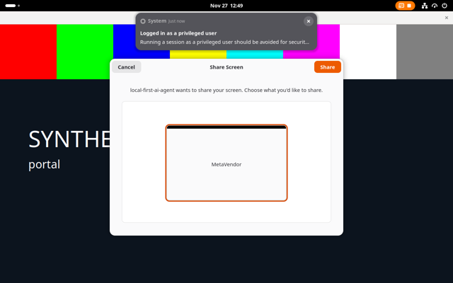
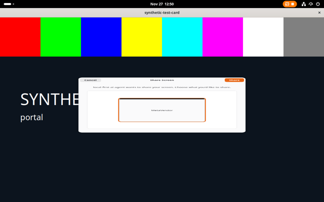
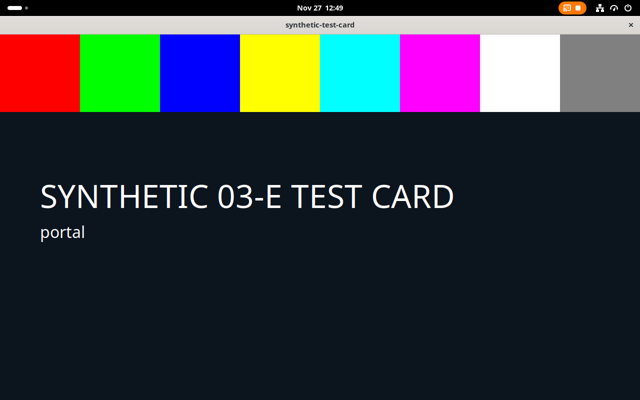

# 03-E entry gate G1: ScreenCast portal and PipeWire single-frame feasibility

2026-11-27. This is the time-boxed investigation required by D-033 before any
03-E capture code. **It is evidence for the owner's mechanism decision (G2,
OQ-13). It is not an approval, and no production capture code was written.**

## Environment and method

- Host: Ubuntu 26.04, GNOME Shell 50.1, xdg-desktop-portal 1.21.1,
  xdg-desktop-portal-gnome 50.0, PipeWire 1.6.2, GStreamer 1.28.2,
  i5-8500, software rendering.
- The owner's session was not used for capture. Each run started a
  disposable headless GNOME Shell (`--headless --virtual-monitor 1280x800`)
  inside `unshare --user --map-root-user --net`, with no network. The
  session had its own D-Bus, PipeWire, WirePlumber, permission store,
  xdg-desktop-portal and GNOME backend. A temporary profile was deleted with
  the namespace.
- Content was a synthetic test card (colour bars and the text "SYNTHETIC 03-E
  TEST CARD").
- The real consent dialog was approved or cancelled with pointer clicks
  through Mutter's RemoteDesktop API in that private session. That is the
  same input path a user's click takes. Hot corners were disabled so the
  virtual pointer could not open the Activities overview.
- Two probes (in `probe/`): `mutter_probe.py` uses Mutter's private
  ScreenCast API (the backend the portal uses), and `portal_probe.py` uses
  `org.freedesktop.portal.ScreenCast` version 5 exactly as an application
  would. Raw results are in `mutter-results.json` and `portal-results.json`.
- The live session (read only, nothing bound or captured) exposes
  ScreenCast version 5 with source types monitor, window and virtual, and
  the host Registry.

To reproduce, run from the repository root:
`AGENT_REPO=$PWD unshare --user --map-root-user --net sh docs/feasibility-03-e/probe/session.sh docs/feasibility-03-e/probe sh docs/feasibility-03-e/probe/with-portal.sh python3 -I docs/feasibility-03-e/probe/portal_probe.py <out> '[{"persist":0,"action":"share"}]'`

The production fixtures reuse this harness. `capture_driver.py` drives
`capture::tests::portal_frame_overlay_and_ocr_in_a_headless_session`, and
`capture_loop_driver.py` drives the repeated-capture fixture
`capture::tests::back_to_back_captures_in_a_headless_session` (set
`AGENT_CAPTURE_OUT` and `AGENT_CAPTURE_CYCLES`; `AGENT_CAPTURE_COMPETE=1`
adds a competing screencast client). The loop driver opens no screencast of
its own, because extra screencasts in the same compositor compete with the
fixture's. See [stage 03-E](../stage-03-e-screen-intelligence.md#capture-reliability).

## Measurements

### Portal path (consent dialog, `OpenPipeWireRemote`, one frame)

Six approved cycles with a dialog, one cancelled, and two restored without a
dialog. Times are in milliseconds.

| Step | Result |
|---|---|
| `CreateSession` / `SelectSources` responses | 4–5 / 3.3–3.7 |
| `Start` to consent dialog visible | 710 cold (first in session); 143–196 warm |
| Share click to `Start` response | 1.5–2.5 |
| Cancel click to `Start` response (code 1) | 129–193 |
| `OpenPipeWireRemote` to first frame in memory | 34–46 |
| `OpenPipeWireRemote` to first frame **without the dialog** | 68–71 warm, 112–116 cold (1–3 frames dropped) |
| Restored session (no dialog) to clean frame | 46 (0 dropped) |
| `Session.Close` to PipeWire node removed | 17–22 |
| Leftover PipeWire nodes after all cycles | none |

After approval, a clean in-memory frame took about 70 ms (about 115 ms cold),
plus the time the user takes to decide. A 1280×800 RGB frame is 3,072,000
bytes in process memory.

### Mutter backend (no portal; 12 cycles)

| Step | min | p50 | p95 | max |
|---|---|---|---|---|
| Session start to stream node | 4.4 | 4.6 | 4.9 | 6.7 |
| Node to first frame | 26.3 | 42.5 | 43.2 | 43.2 |
| Start to first frame | 30.8 | 47.1 | 47.8 | 48.1 |
| Stop to node removed | 14.7 | 15.0 | 15.3 | 15.3 |

- An 800×600 `RecordArea` capture reached its first frame in 28 ms.
  `RecordArea` is private to Mutter. The portal has no region source.
- Stopping right after the node appeared, with no frame taken, removed the
  node in 15.6 ms.
- A frozen overlay painted from the in-memory frame (full screen, dimmed)
  first drew 60 ms after it was shown.

## Findings

1. **Single-frame in-memory capture is practical.** Frames arrive over the
   PipeWire fd from `OpenPipeWireRemote` straight into process memory
   (memfd buffers). No image file was written. Afterwards the profile held
   the compositor's Mesa shader cache, logs, and (only for `persist_mode=2`)
   a 457-byte permission-store entry. None of it contains pixels. Acceptance
   check 8 is achievable on this path, unlike with the Screenshot portal
   (OQ-13).
2. **Consent.** The GNOME dialog names the app from its desktop file
   ("local-first-ai-agent wants to share your screen") and preselects the
   single monitor. With `persist_mode=0`, each capture shows the dialog and
   nothing is stored.
3. **Persisted consent removes the dialog.** With `persist_mode=2`, the
   portal returns a restore token and writes a permission-store entry. A
   later request with that token skipped the dialog entirely and returned a
   frame in 46 ms. That would allow capture without any per-capture
   prompt, so it needs an explicit owner decision and disclosure. The
   recommendation is `persist_mode=0`.
4. **App identity is enforced.** `org.freedesktop.host.portal.Registry`
   refused the app ID ("App info not found") until the desktop file was
   installed *and* its `Exec` binary was on `PATH`. The Debian package
   provides both. A build that is not installed cannot use the portal. The
   03-D shortcut code handles the same failure by reporting the shortcut as
   unavailable.
5. **The first frame shows the consent dialog.** The first frame after
   approval captured the dialog's closing animation
   (`first-frame-closing-dialog.png`). Production capture must drop frames
   until the dialog is gone: 1–3 frames, about 35–70 ms. Watching for
   consecutive stable frames, or a short settle time, is more robust than
   the single-pixel check used here. Restored sessions had no such frame.
6. **The privacy indicator is visible.** GNOME's orange screen-sharing
   indicator appeared in the top bar while a stream was open, and already in
   the first frame. Full-monitor frames include it. Its disappearance after
   `Close` could not be checked independently, because observing it needs
   another screencast. The removal of the PipeWire node was verified.
7. **There is no portal region source.** The portal offers monitor, window
   or virtual sources. A region must be cropped in the app from a full
   monitor frame, so every pixel of that monitor is in memory briefly. The
   frame should be cropped and the full buffer dropped right after
   selection.
8. **Overlay.** The frozen overlay must open after the stream closes. A
   capture taken while the overlay was up saw the dimmed overlay, not the
   content (0 of 2000 red test-card samples). A full-screen GTK window
   drew the frozen frame in 60 ms. GNOME has no layer-shell, so the overlay
   is an ordinary full-screen window.
9. **Cancellation and cleanup.** A user cancel returns response code 1
   with no stream. Closing the app side before the first frame, or right
   after it, removed the node in 15–22 ms and left nothing behind.
10. **Dependencies.** Production use needs a PipeWire consumer in Rust
    (for example `pipewire-rs` over libpipewire, or GStreamer). That is a
    new native dependency and needs owner approval.

## Not covered (D-039, G3)

- Real GPU sessions. The headless compositor used software rendering and
  shared-memory buffers. Real hardware may offer DMA-BUF buffers that must
  be negotiated or downloaded.
- Multiple monitors, HiDPI and fractional scaling (the session had one
  1280×800 monitor at scale 1), and window sources.
- KDE Plasma (xdg-desktop-portal-kde), wlroots compositors and X11.
  GNOME 50 has no X11 session. Other desktops depend on their own portal
  backend.
- Human consent timing, and the indicator as a person perceives it in the
  real session. Both belong to owner acceptance.

## Recommendation for G2 (owner decision)

Use the ScreenCast portal with a monitor source and `persist_mode=0`. Take
one frame into memory after the dialog's frames are gone, close the session
immediately, then show the frozen overlay from memory and crop the selected
region. Drop the full frame as soon as the region is selected. Do not use
the Screenshot portal (D-034). Environments without a ScreenCast portal stay
unsupported for region capture. The open decisions are: per-capture consent
versus persisted consent, approval of the PipeWire dependency, and how to
disclose the brief full-monitor frame held in memory.

