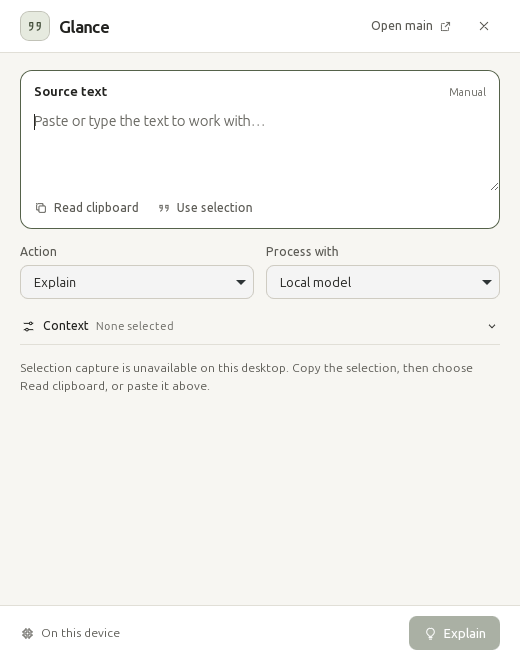
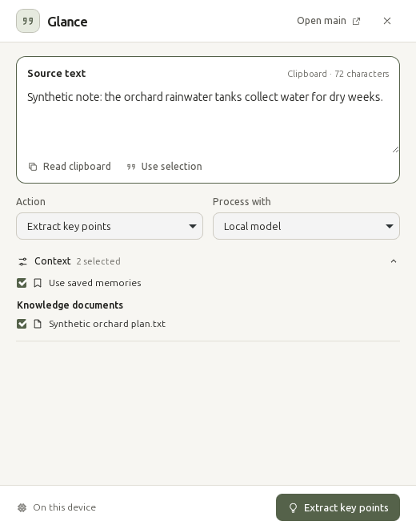
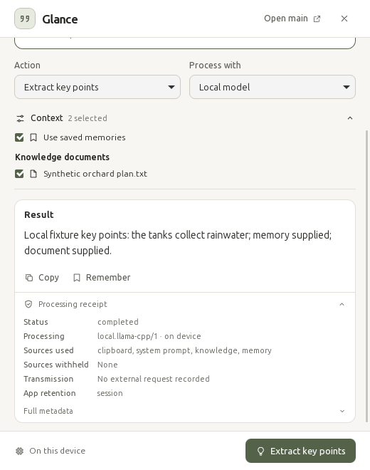
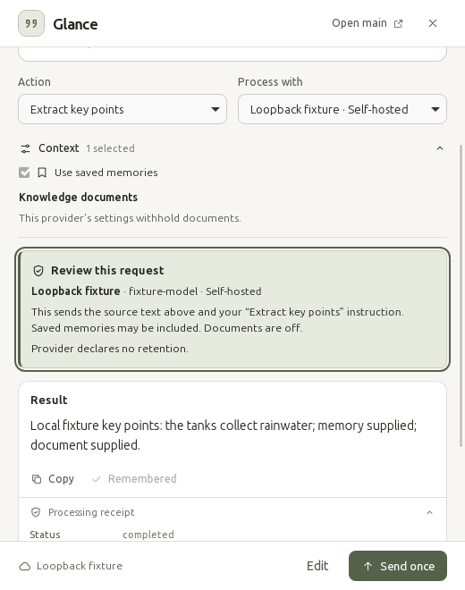
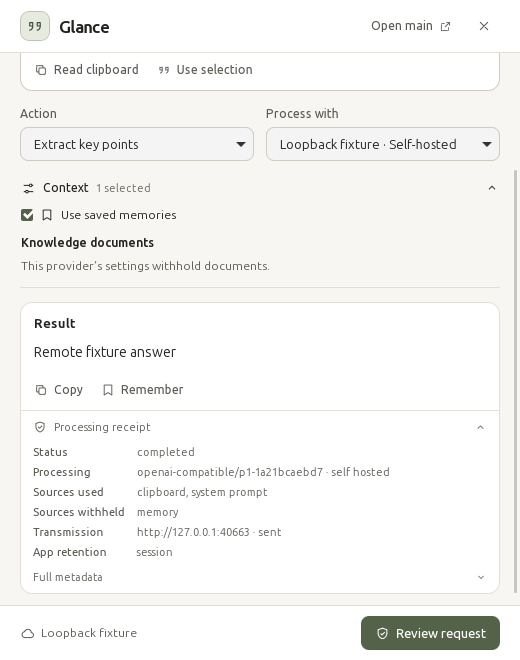
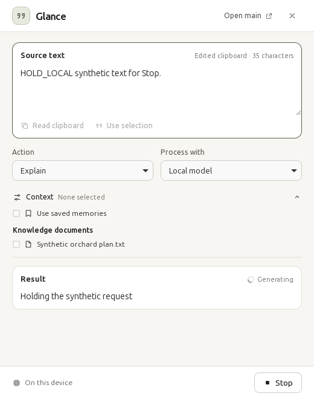
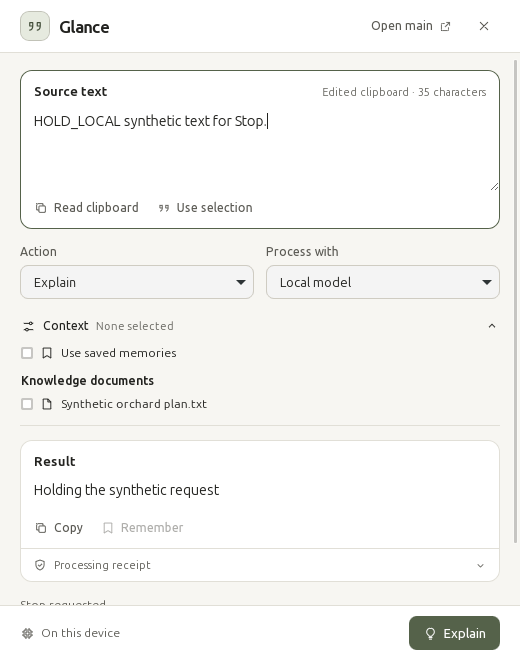
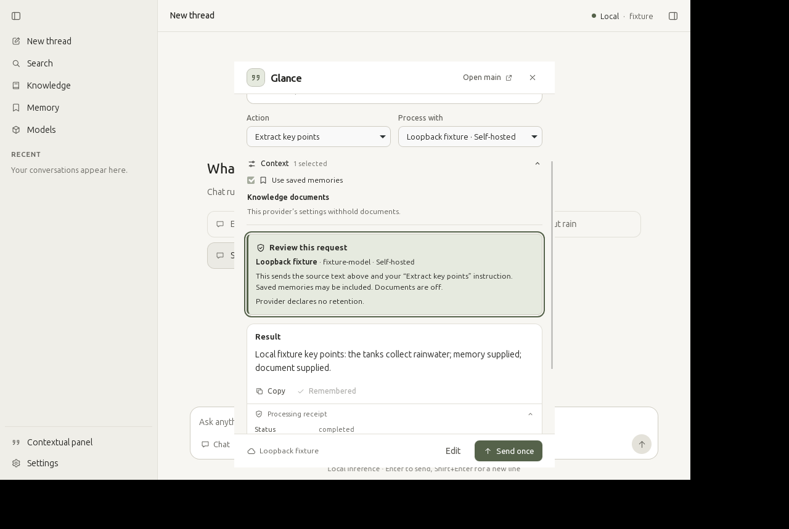

# Stage 03-D contextual text summon

This record applies Blueprint v1.3 and the v0.3.0 plan (D-031, D-032, D-039,
D-049, D-050) on top of the 03-C corrective commit `40bfecb`. Implementation
began with Codex and was completed after a handover. Everything below was
checked against the working tree, not the handover notes.

## Decisions applied

- **D-031.** Portal-first global shortcut. Activation tokens are forwarded.
  The app identity matches the desktop file. A command fallback forwards to a
  single instance, with debouncing.
- **D-032, D-049.** Automatic selection capture is off. The panel never
  reads PRIMARY, never synthesizes Copy and never replaces the clipboard
  without a Copy click. **Use selection** explains the copy-and-paste path.
  Opening the panel captures nothing.
- **D-050.** Output is plain text. The panel cannot navigate away from its own
  page, and new windows are denied, so links have no launch path.

## Activation

- `summon.rs` claims a lock in the private `XDG_RUNTIME_DIR` before Tauri
  opens the profile. A second process sends one datagram (`P` for the
  panel, `W` for the main window, plus an optional token) and exits. The
  primary accepts only those two message kinds, with printable tokens of
  1024 bytes or less. A stale socket is reclaimed.
- The token comes from `XDG_ACTIVATION_TOKEN` (Wayland) or
  `DESKTOP_STARTUP_ID` (X11). It is applied with `set_startup_id` before the
  panel maps. A repeated summon raises the existing panel with the new token
  and keeps its session.
- Repeated activations within 250 ms are dropped, and each drop extends the
  window. Holding the shortcut cannot reopen a dismissed panel.
- `summon_portal.rs` uses its own session-bus connection and registers
  `io.github.gimesha-adikari.localfirstaiagent` with the host Registry
  before any GlobalShortcuts call. That stops an IDE's identity from
  acquiring the permission. At startup it rebinds only a shortcut that was
  already approved. A new binding happens only from **Settings → General →
  Configure desktop shortcut…**. Only `Activated` signals for the app's
  own session and shortcut ID are accepted. Losing the portal or session
  marks the shortcut unavailable. `ConfigureShortcuts` is offered only on
  GlobalShortcuts version 2 or later.
- The Debian package installs
  `io.github.gimesha-adikari.localfirstaiagent.desktop` with a
  **Summon** action (`--summon`). The legacy launcher remains, hidden, for
  upgrades.

## Panel host

- `panel.rs` opens a single `panel` WebView window. The window starts hidden
  so the token is set first, then `show_all` and `present` map it. Its
  navigation is restricted to `index.html?glance=1` on the app origin.
- **Not incognito.** On WebKitGTK, wry drops the ephemeral context that owns
  the `tauri://` handlers, which left the panel on `about:blank`. The
  isolated fixture showed this. The panel keeps nothing in web storage: text,
  answers and receipts live in React state and in the host's memory only.
- The `panel` capability grants only the eight panel commands. The main
  window has `glance_show` and the shortcut commands, but no panel commands.
  Every panel command also checks the window label.
- Closing the panel (Escape, the close button, **Open main**, window
  destruction, or the 10-minute limit) cancels any running request and
  clears the clipboard text, answer and receipt. A dismissed panel has no
  session.

## Contextual intelligence

- `engine::chat::glance` reuses the Chat worker, the operation lease and the
  provider gateway. A running panel request makes Chat return Busy, and the
  reverse is also true. Provider deletion and local-only switching keep
  their 03-C guarantees.
- There are eight existing recipes: Explain, Summarize, Rewrite, Improve,
  Grammar, Translate, Key points and Custom question. No new action kinds
  were added.
- Requests are ephemeral. No conversation, message, checkpoint, context
  attempt or receipt row is written. The receipt is returned with
  `application_retention: session`. Usage ledger rows for remote requests
  carry no message link.
- The source text is a quoted JSON field under a system prompt that treats it
  as untrusted. Chat history is never included.
- **Knowledge and memory.** Explicitly selected documents use keyword
  retrieval, and memories use the existing relevance ranking. Both are
  optional background (`EvidenceTask::ContextualBackground`). Memory stays
  off when retrieval is disabled in the main window. A provider whose
  sharing settings withhold memories or documents never receives them.
- **Sharing.** A provider request needs the panel's review step and **Send
  once** (`share: true`). It also needs a provider revision hash that matches
  the reviewed settings, and a non-local-only profile. It then passes the
  same policy consent and egress checks as Chat. `core.clipboard-text/1` is
  admitted only for the `glance` purpose.
- **Clipboard.** Reading needs a button press. A native GTK read runs with a
  5-second Observe grant and is limited to 8192 bytes. The text appears in
  an editable preview before anything is processed. The source is labelled
  Clipboard, Edited clipboard or Manual.
- **Remember** is the only write. It requires a completed answer, works once
  per answer, and is authorized as `explicit.glance-remember/1`. The
  memory row records provenance (`contextual_panel`,
  `explicit_user_remember`, provider and sources used) and keeps the
  answer's labels. Schema 15 adds the two nullable columns. Older memories
  keep their conservative `core.memory/1` label.
- **Stop** keeps the partial text visible with a cancelled receipt, like
  Chat. Remember is refused for it.

## Verification

All checks used synthetic content. No paid or third-party provider was
contacted.

- Engine: 85 passed, 3 ignored. New tests:
  `local_glance_uses_selected_context_without_persisting_or_history`,
  `local_glance_stops_holds_the_chat_gate_and_refuses_to_remember_partial_output`,
  and Codex's remote
  `glance_uses_the_gateway_without_chat_history_or_persisting_text`.
- Storage: 59 passed. Four upgrade fixtures now remove the schema-15
  columns before they downgrade. New test:
  `schema_fourteen_memories_upgrade_without_provenance_and_panel_memories_keep_theirs`.
- agent-core: all suites passed. Desktop: 20 passed, 17 opt-in ignored,
  including five summon and portal tests (cross-process forwarding, stale
  socket, debounce, token ownership, early portal response on a private
  bus).
- Release Clippy (workspace, all targets, `tauri/custom-protocol`,
  `-D warnings`): clean. `cargo fmt --check`: clean.
- Frontend: 68 tests, type-check and production build.
- **Native panel** (`glance_panel_desktop_fixture`): real WebViews,
  Xvfb, a private D-Bus session, a loopback-only network namespace, a
  disposable profile and an external `xclip` clipboard owner. Passed
  12 steps (see the screenshots below). After the run, no source text,
  remote answer or stopped text was found anywhere in the profile.
- **Command fallback with the release binary** (12 cycles, Xvfb, no network).
  Times run from the `--summon` process start:

  | Measure | min | p50 | p95 | max |
  |---|---|---|---|---|
  | Panel window mapped | 28.6 ms | 32.0 ms | 97.7 ms | 109.3 ms |
  | Panel content drawn | 470 ms | 510 ms | 645 ms | 701 ms |

  A burst of three summons gave one panel. A summon while the panel was open
  kept the same window. Escape closed the panel in every cycle. A plain
  launch forwarded to the running instance and exited in 32 ms without
  opening the panel.
- **Real portal (read only).** Ubuntu GNOME 50 on Wayland,
  xdg-desktop-portal 1.21.1: host Registry present, GlobalShortcuts version
  1. No shortcut was bound and no permission was requested.

### Screenshots

Taken from `glance_panel_desktop_fixture` on Xvfb and cropped to the panel.

| | |
|---|---|
|  |  |
|  |  |
|  |  |
|  |  |

## Running the opt-in fixture

Build the test binary with `--features tauri/custom-protocol`. Without it,
the WebView loads the development server URL. Then run
`desktop_acceptance::glance_panel_desktop_fixture` under
`unshare --user --map-root-user --net` (loopback up), `dbus-run-session`
and `xvfb-run -s "-screen 0 1280x860x24"`. Use a disposable `HOME` and
XDG directories, with `AGENT_ACCEPTANCE_PROFILE` set to the profile. Start
an external clipboard owner first (`xclip -selection clipboard -i`).
Setting `AGENT_GLANCE_SCREENSHOTS` to a directory saves full-screen captures
with the panel's geometry.

## Limitations

- **Summon latency.** Every summon builds a new WebView. Content took about
  0.5 s at p50 on Xvfb with software rendering. That misses the candidate
  150 ms target, which remains unconfirmed. Pre-warming a hidden panel
  would need a reset-on-dismiss design and an owner decision.
- **Supported environments (D-039, G3).** Only isolated Xvfb was exercised.
  Ubuntu GNOME Wayland portal behaviour (consent dialog, focus with a real
  token), KDE, other X11 sessions, multiple monitors and HiDPI are
  unverified. These belong to owner acceptance in 03-F.
- **Explicit selection capture (G4)** is not enabled. No environment has
  verified current-selection provenance yet.
- With no window manager on Xvfb, focus return after dismissal and token
  focus behaviour were not observable.
- **Portal identity needs an installed desktop file.** The host Registry
  rejects the app ID unless
  `io.github.gimesha-adikari.localfirstaiagent.desktop` is installed and its
  `Exec` binary is on `PATH`. The 03-E investigation showed this. A build
  run from `target/` therefore reports the shortcut as unavailable. That
  fails closed, and the `--summon` command fallback still works. The Debian
  package provides both.
