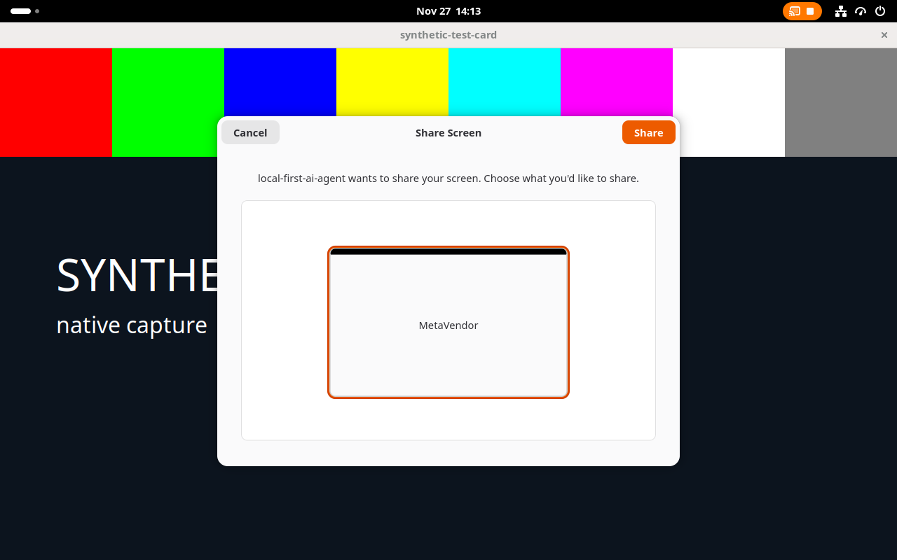
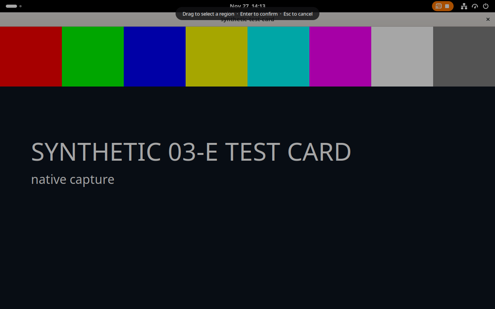
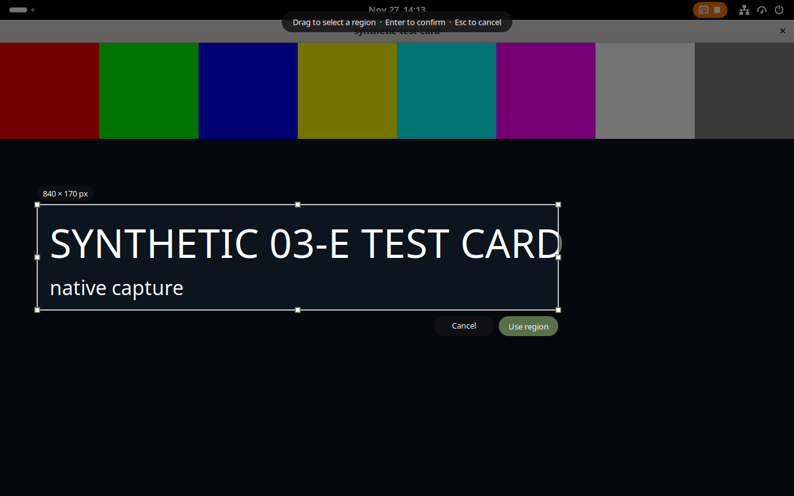
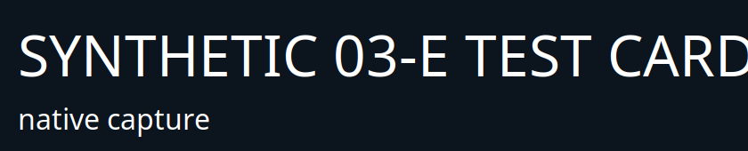
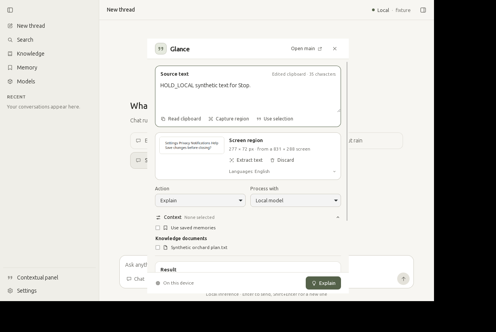
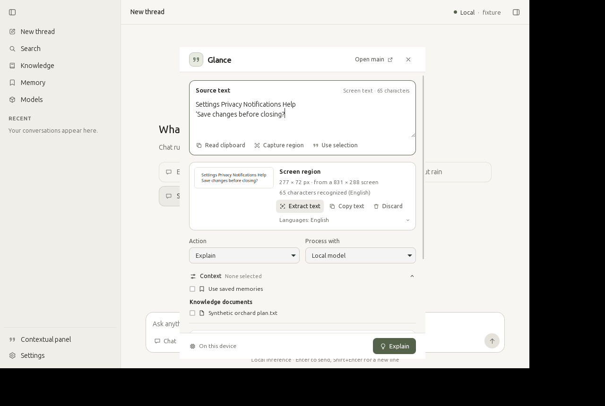
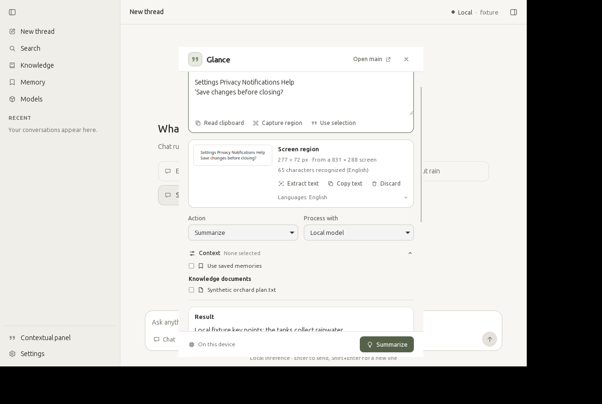
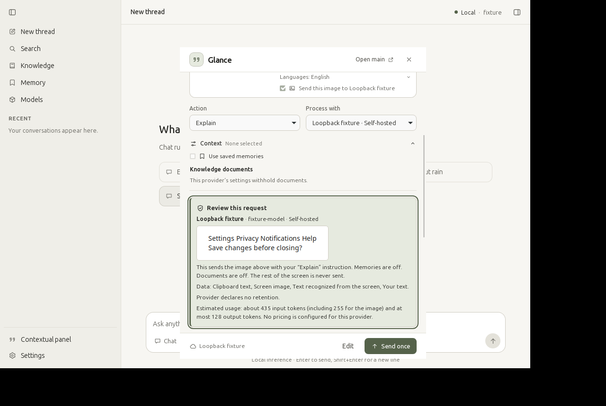
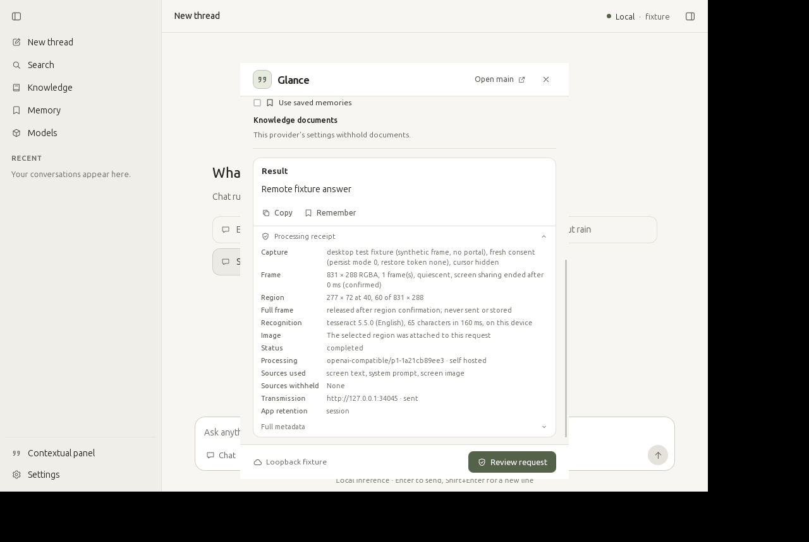

# Stage 03-E screen intelligence (production) and 03-F preparation

This record applies Blueprint v1.4 (D-051 to D-056; context checkpoint
`7b4e588`) on top of 03-D at `189671f`. All results use synthetic content and
disposable profiles. **Measured** means run on the development machine (Intel
Core i5-8500, Ubuntu 26.04, GNOME 50.1, PipeWire 1.6.2, Tesseract 5.5.0).
Every graphical run was headless (Xvfb, or a headless GNOME Shell with
software rendering). None of these results show real-desktop behaviour.

## Decisions applied

- **D-052, D-053.** The ScreenCast portal and PipeWire are the only capture
  path:
  - Every capture is an explicit gesture with fresh consent: portal version
    4 or later, `persist_mode = 0`, and no restore token requested, stored
    or reused (a returned token is recorded and dropped).
  - There is no file fallback, no continuous or startup capture, and no
    resumption.
- **D-054.** One bounded frame is held in memory. The portal session is
  closed before the overlay appears, and the full frame is wiped once the
  crop is confirmed. Only the crop stays in the session, as a PNG that is
  wiped on drop.
- **D-055.** Nothing is analysed automatically. Text recognition runs only on
  request. Remote processing needs the per-request review: the exact crop
  (bound by crop ID) or the derived text, with data classes, retention and
  an estimate shown first.
- **D-056.** Frames are taken by quiescence, not a fixed frame count. The user
  previews the frozen frame and confirms the region. No claim of
  dialog-free capture is made.

## Architecture

| Layer | Location | Role |
|---|---|---|
| Frame logic | `agent-core::screen` | Ten packed RGB formats, stride, offset and size validation, region mapping (HiDPI and fractional), crop, settle policy, zeroed buffers |
| Classes | `agent-core::classification` | `core.screen-image/1` (RawSensor, confirmed crops only) and `core.screen-text/1`; recognized text inherits the crop's labels |
| Portal | `desktop/portal_bus.rs`, `capture/portal.rs` | Private identity-registered bus, request timeouts and cancellation (Request.Close), ScreenCast consent |
| Frame | `capture/pipewire.rs`, `capture/spa.rs` | libpipewire loaded at run time, hand-built SPA POD format and buffer negotiation, MemPtr and MemFd only (DMA-BUF rejected), quiescence settling, teardown |
| Overlay | `capture/overlay.rs` | Native full-screen GTK window painting the frozen frame from host memory; never a WebView |
| Session | `panel_screen.rs` | Crop, panel-only `glance-crop:` protocol, OCR, origin labels, image attachment, receipts |
| OCR | `agent-tools::sandbox`, `agent-tools::ocr` | Tesseract fast models in the shared Bubblewrap, seccomp and prlimit sandbox |
| Engine | `engine::chat::glance` | Screen text and image requests through the existing gateway, budget and policy; `estimate_glance` |
| UI | `Glance.tsx` | Capture region, crop preview, Extract text, languages, Copy text, Discard, Send this image, review and receipts |

The engine never sees a full frame or any OS API. Platform code stays in the
desktop host (INV-12).

## Glance warm panel (Phase 2)

Commit `5992d64` keeps one empty, hidden panel loaded:
- **No session until summoned.** Every panel command fails until a summon
  starts one, and the page requests nothing until it is visible.
- **Dismissal wipes state.** It cancels work, clears the session, hides the
  window and reloads the page.
- **No stale content.** A summon that arrives during the reload is shown
  only after the fresh page has loaded.

Release binary, command fallback, 12 summons on Xvfb; PSS covers the app
and its WebKit processes:

| | On demand (03-D) | Warm |
|---|---|---|
| Content ready, p50 / p95 | 474 / 477 ms | 28 / 32 ms (first summon 66 ms) |
| Window mapped, p50 / p95 | 29 / 30 ms | 26 / 27 ms |
| PSS at idle | 1426 MB | 1463 MB (+37 MB) |
| PSS after 12 summons / after 40 | 1426 / 1417 MB | 1496 / 1499 MB (plateau, about +80 MB) |

Typed synthetic text was gone after dismissal and re-summon. Burst, repeat
and plain-launch forwarding checks passed. The panel fixture also checks the
hidden window, the reloaded empty page and a fresh session. Adopted: a
17-fold faster summon for a fixed memory cost that does not grow with use.
Software rendering inflates PSS; real GPU figures are unmeasured.

## Capture

**Native headless-GNOME fixture.** `capture::tests::portal_frame_overlay_and_ocr_in_a_headless_session`
uses the real portal and backend, approved by synthetic pointer clicks
(driver: `docs/feasibility-03-e/probe/capture_driver.py`). Results from
the final code:

| Check | Result |
|---|---|
| Cancel in the consent dialog | `Denied` (response code 1) about 1.5 s after the request |
| Share with fresh consent | Portal version 5, no restore token returned, permission store `screencast` empty afterwards |
| Stream | BGRx 1280×800, first frame 29–30 ms, 3–4 frames, settled `quiescent` after 285–301 ms, 0 rejected buffers |
| Session closure | `Session.Close` and connection close in 4 ms (G1 measured PipeWire node removal at 17–22 ms) |
| Cancel during acquisition | Stops before any frame, session closed |
| Overlay | Opened after closure; a drag mapped to an 840×170 region; Return or Use region confirmed |
| OCR of the crop | "SYNTHETIC 03-E TEST CARD / native capture" in 147–316 ms, with the sandbox nested inside the test's user namespace |
| Profile | No image file; only shell, GStreamer and IBus caches and the stub desktop entry |

One run in seven failed with `Unavailable` on a consent requested within
milliseconds of the previous session's closure. It failed safely and
captured nothing. The final hardening traced it to the test harness, not to
session teardown; see [capture reliability](#capture-reliability).

### Screenshots

| | |
|---|---|
|  |  |
|  |  |

The orange indicator in the overlay's top bar is part of the frozen frame,
captured while the consented stream was live. The harness's own screenshot
session also shows one. The overlay draws the hint, the dimmed outside,
handles, the size badge and Cancel / Use region.

Panel screen flow (Xvfb, synthetic frame through the production crop path):

| | | |
|---|---|---|
|  |  |  |
|  |  | |

## OCR

**Containment.** These opt-in tests run Python as a stand-in for a
compromised Tesseract inside the OCR sandbox:
- **Network and processes:** AF_INET and AF_UNIX sockets are denied, and
  fork is denied.
- **Filesystem:** `/home`, `/etc/passwd` and `/run/user` are absent, and
  `/usr` is read-only.
- **Environment:** cleared.
- **Limits:** a 1.5 GiB allocation fails (1 GiB address-space cap), a busy
  loop is killed at the CPU limit (exit 152), and a 4 MiB write exceeds
  the 1 MiB file-size cap.
- **Cancellation:** the process is stopped and reaped, and no process
  survives.

Real Tesseract checks: a malformed or truncated PNG returns Invalid, an
unknown or empty language list returns Language, and cancellation returns
Cancelled. The image enters through a pipe as an in-memory file. 03-0
suggested Landlock instead; Bubblewrap is used because the shipped PDF
sandbox already relies on it and Ubuntu's `bwrap-userns-restrict`
AppArmor profile permits it under `apparmor_restrict_unprivileged_userns=1`.

**Quality.** 23 Pango-rendered synthetic UI samples, each at 14 px, 20 px
and 16 px dark (69 images), run through the production sandbox. CER is the
edit distance with whitespace removed. Models are the official
`tessdata_fast` files, fetched only into the measurement scratch area (hashes
recorded there); `eng`, `sin` and `tam` are the system packages.

| Script | Data | CER min / mean / max | ms p50 | Model MB |
|---|---|---|---|---|
| Latin | eng / spa / fra / deu / por / vie / tur / ind | 0.012 / 0.000 / 0.025 / 0.006 / 0.000 / 0.016 / 0.000 / 0.000 (means) | 94–125 | 0.5–4.6 |
| Cyrillic | rus / ukr | 0.006 / 0.000 | 66–67 | 3.8–3.9 |
| Han | chi_sim | 0.059 / 0.059 / 0.059 (full-width ？ read as ?) | 154 | 2.5 |
| Han | chi_tra | 0.059 / 0.196 / 0.471 (one 20 px sample failed badly) | 162 | 2.4 |
| Japanese | jpn | 0.038 / 0.051 / 0.077 | 179 | 2.5 |
| Hangul | kor | 0 / 0 / 0 | 88 | 1.7 |
| Arabic | ara | 0 / 0 / 0, but some word spaces were lost (CER ignores whitespace) | 69 | 1.4 |
| Hebrew | heb | 0.022 / 0.037 / 0.067 | 53 | 1.0 |
| Devanagari | hin | 0 / 0 / 0 | 74 | 1.1 |
| Bengali | ben | 0 / 0 / 0 | 61 | 0.9 |
| Thai | tha | 0 / 0.045 / 0.119 | 67 | 1.1 |
| Sinhala | sin | 0.053 / 0.070 / 0.105 (zero-width non-joiners added) | 83 | 1.7 |
| Tamil | tam | 0.068 / 0.068 / 0.068 | 71 | 3.2 |
| Mixed | eng+chi_sim | 0 / 0 / 0 | 256 | 6.6 |
| Mixed | eng+ara | 0.125 / 0.146 / 0.156 (bidi marks U+200E/U+200F kept; they count as insertions) | 141 | 5.5 |

**Per-script regression thresholds** (mean CER; gated by
`crates/tools/tests/ocr_languages.rs`): Latin, Cyrillic, Arabic, Devanagari,
Bengali and Hangul 0.03; Hebrew and Thai 0.08; Japanese 0.10; Sinhala and
Tamil 0.12; Han and mixed 0.20. The English fixture in the normal suite allows
0.05 at 14 px.

These are synthetic, clean, single-font samples. They do not represent real
screens, low contrast, unusual fonts or handwriting, and accuracy is not
equal across scripts. G7 is decided by D-058: these are initial synthetic
regression thresholds, not accuracy guarantees.

**Starter set** (G6, decided by D-057; see [OCR decisions](#ocr-decisions-g6-g7)).
The package depends on `tesseract-ocr-eng` (3.9 MB installed). Spa, fra,
deu, por, rus, ara, hin, chi-sim, jpn and kor (about 19.3 MB installed) are
recommended optional packs, chosen for global coverage and measured quality
within the thresholds; they are documented and suggested in the panel, not
installed automatically. Other optional packs: chi-tra (unreliable in one
sample), vie, tur, ind, ukr, heb, ben, tha, sin, tam, and any other installed
`tesseract-ocr-*`.
The panel lists installed data, defaults to the locale's language plus
English, and allows up to four languages.

## Screen intelligence, privacy and receipts

- **Actions.** Extract text (local OCR) and Copy text. Explain, Summarize,
  Translate, Ask and Remember use the existing recipes on recognized text,
  locally or remotely. "Send this image" is available only for providers
  with image input, and is refused for local and text-only targets (no
  silent switch). There is no local vision model.
- **Labels.** Recognized text carries `screen-text` and `screen-image`, plus
  `clipboard-text` if the session read the clipboard; editing never removes
  them. Screen classes are admitted to egress only for the panel purpose,
  and only after the per-request review.
- **Local-only.** Local-only mode allows authorized local capture,
  sandboxed OCR and on-device processing of the recognized text. It
  refuses remote image and remote text requests, hides providers in the
  panel, and revokes live remote grants when turned on, which stops a
  streaming request. Receipts keep the transmission that had already
  happened. (An earlier wording said Local-only "blocks screen and image
  requests"; it blocks only their remote processing.)
- **Image authorization.** An image is attached only when the request names
  the current crop ID, so a stale or forged ID is refused. Size is capped
  at 3 MiB (an oversized crop is refused, not rescaled). Image tokens are
  added to the budget reservation.
- **Protocol.** The crop is served only to the `panel` WebView with
  `Cache-Control: no-store`. The main window and dismissed sessions get
  403 or 404 (fixture-verified). The CSP allows `img-src 'self' glance-crop:`
  only. No frame passes through IPC.
- **Receipts.** The capture source, portal version, persist mode,
  restore-token status, cursor, stream format and settling, closure time,
  region and frame size, OCR engine, languages and timing, whether the
  image was attached, and the full frame's fate. No pixels. The engine
  receipt adds sources used and withheld, labels, locality, transmission,
  usage and retention.
- **Persistence.** Panel requests write nothing except an explicit Remember.
  After the Xvfb screen flow, the profile contained no PNG and no recognized
  text (fixed-string scan), and WebKit's cache held only its salt.

## Verification

Consolidated regression on the final code:
- **Workspace tests:** 281 passed, 0 failed, 53 opt-in ignored. That is
  agent-core 69, tools 31, engine 86, inference 11, desktop 25, storage 59.
- **Static checks:** release Clippy (workspace, all targets,
  `tauri/custom-protocol`, `-D warnings`) and rustfmt are clean.
- **Frontend:** 69 tests, type-check and production build.

Opt-in checks run:
- **PDF sandbox** tests (after the shared-runner refactor): 4 passed.
- **OCR** containment and English: 4 passed.
- **Multilingual OCR** thresholds against measurement data and against the
  system data: passed.
- **Native capture fixture:** passed in six of seven runs (see above).
- **Desktop WebView fixtures:** `unified_ipc_desktop_fixture` (main Chat and
  Agent compatibility), `providers_ipc_desktop_fixture` and
  `glance_panel_desktop_fixture` (16 steps, including the screen flow)
  passed.

The engine's loopback tests cover:
- exact crop bytes on the wire;
- refusal before any request for a text-only provider, a missing crop or no
  confirmation;
- screen-label inheritance;
- Local-only refusing remote screen and image requests;
- no persistence.

The panel fixture's loopback provider decoded the single image it received:
it measured exactly the crop's size, never the larger frame.

## Limitations

- **Real desktops are untested (D-039, G3):** real GPUs and DMA-BUF-only
  producers (rejected by design), multiple monitors, HiDPI and fractional
  scaling on a real compositor, KDE, wlroots and X11. Only one 1280×800
  headless monitor at scale 1 was exercised.
- **Overlay keyboard focus** on a real compositor depends on its focus policy,
  because the overlay has no activation token after the portal dialog. A
  click focuses it, and the mouse buttons always work. In the harness,
  synthetic-input sessions moved focus.
- **Portal stalls.** With other screencast clients active in the same
  session, xdg-desktop-portal once stopped answering for about 70 s. The
  app cannot correct this; it fails with a retryable message and captures
  nothing (see [capture reliability](#capture-reliability)).
- **OCR results are synthetic** (see the quality section). G6 and G7 are
  decided (D-057, D-058); thresholds are regression gates, not accuracy
  guarantees. In the final native run the synthetic card's "CARD" was read
  as "CARE".
- **Runtime directory.** The single-instance socket (03-D) lives in
  `XDG_RUNTIME_DIR`; a path longer than about 100 bytes stops startup. The
  systemd default `/run/user/<uid>` is short; only synthetic test setups hit
  this.
- **No remote vision provider was contacted.** Image requests were verified
  only against the loopback fixture.
- Commit `b5c73e4` does not build on its own (its module declaration landed
  in `ca7e66b`). The branch head builds and passes.

## Owner acceptance checklist for 03-F

Superseded by the consolidated [v0.3.0 owner acceptance guide](v0.3.0-owner-acceptance.md);
the list below is kept as the original 03-E record.

1. Install the Debian package on Ubuntu GNOME (Wayland). Confirm that the
   desktop entry, Summon action and portal identity show the app's name.
2. Bind the shortcut in **Settings → General** and summon from another app.
   Check focus and dismissal focus return, and that the panel is ready about
   instantly after the first summon.
3. **Capture region:**
   - The consent dialog names the app.
   - The sharing indicator appears during capture and disappears after.
   - Cancel captures nothing.
   - A second capture asks again.
4. **Overlay:** drag, move, resize, arrow keys, Enter and Escape on a real
   compositor. Check whether the overlay takes keyboard focus without a
   click. Repeat on a HiDPI or fractional-scaling display and on each
   monitor of a multi-monitor setup.
5. Extract text from real application content in your languages, and judge
   accuracy against the recorded thresholds.
6. **Real provider:**
   - With an image-capable provider, review and send one crop, and check the
     receipt and the provider's usage.
   - With a text-only provider, confirm the image option is absent.
   - Toggle Local-only during a request.
7. Dismiss during capture, during OCR and during a remote request. Reopen
   and confirm nothing remains. Check `~/.local/share`, `~/.cache` and `/tmp`
   for images or text.
8. Main window: Chat, Agent, Knowledge, Memory and Providers still behave as
   in 03-C and 03-D.
9. KDE Plasma and an X11 session, if support is to be claimed.

## v0.3.0 final hardening

Engineering hardening after provisional 03-E acceptance. No new product
capability. Same machine and headless environments as above.

### Capture reliability

**Investigation.** A repeated-capture fixture
(`capture::tests::back_to_back_captures_in_a_headless_session`) asks for
each new consent the moment the previous capture has torn down, and reports
the failing step of any failure. Its driver
(`docs/feasibility-03-e/probe/capture_loop_driver.py`) finds each dialog in
the GNOME portal backend's log and clicks Share with relative pointer motion
through a RemoteDesktop session that has no screencast. The original
driver had polled the screen with its own Mutter screencasts while the
fixture captured.

| Run (headless GNOME 50, portal v5, PipeWire 1.6.2) | Captures | Result |
|---|---|---|
| Original driver (own screencasts while waiting), pre-change code | 20 | 2 succeeded, then `OpenPipeWireRemote` timed out and the portal stopped answering D-Bus calls, including `Registry.Register`, for about 70 s; every failure was safe |
| New driver, no own screencasts, no delay between captures, pre-change code | 30 | 30 succeeded |
| New driver, final code (capture slot, confirmed teardown) | 30 | 30 succeeded; close confirmed 30/30 in 4–7 ms; descriptors 11 → 11, threads 7 → 7 |
| Final code with a competing screencast client polling during consent | 12 | 12 succeeded |
| Final code, competing client and screencast-backed clicks | 12 | 12 succeeded |

The harness also had a startup race: if xdg-desktop-portal started before
the GNOME backend was on the bus, ScreenCast was never exported.
`with-portal.sh` now waits for the backend.

**Conclusion.** Teardown is complete and back-to-back captures succeed
without a delay, so no timed settle was added. The single failure in
seven was the harness's own screencasts competing with the portal. A
portal stall caused by other screencast clients was reproduced once and
cannot be fixed by the app.

**Readiness mechanism** (`capture::Permit`):
- One capture slot per process. It is taken before consent is requested and
  released only after the portal session is closed and the PipeWire stream,
  connection and thread are destroyed.
- A second request while the slot is held is refused at once ("Another
  screen capture is still finishing…"). It is never queued, retried or
  turned into an automatic consent request.
- `portal::close` now waits up to 1 s until the portal no longer exports the
  session; the receipt records whether that was confirmed.
- Failures name the setup step (for diagnosis). A portal that ends a request
  without a user decision (response 2) or does not reply in time is reported
  as "The desktop could not start screen sharing. Nothing was captured. Try
  again." Missing portal or PipeWire support keeps its own message.
- Cancellation is checked before consent and every 25 ms during acquisition,
  as before.

### PipeWire FFI safety checks

| Area | Finding | Action |
|---|---|---|
| Buffer bounds | Frames were read from the whole mapping (`maxsize`), with `chunk.offset` wrapped modulo `maxsize`. Stale bytes past the chunk could be taken as pixels (not memory-unsafe) | Read only `size` bytes at `offset`; a chunk outside the mapping is rejected, never wrapped or clamped |
| Stride | A negative stride (bottom-up rows) was silently replaced by a packed stride | Rejected; zero still means packed rows |
| Dimensions, overflow | `Frame::from_raw` already checks zero and maximum sizes, `MAX_FRAME_BYTES` and every offset with checked arithmetic | No change; tests added for short chunks and extreme values |
| Buffer types | DMA-BUF and unknown types rejected; only MemPtr and MemFd with mapped data accepted | No change |
| Buffer ownership | Each dequeued buffer is queued back before the callback returns; pixels are copied out | No change |
| Callback lifetime | Callbacks run on the loop thread with the loop lock held; the stream is destroyed (removing its listener) under that lock before the hook and shared state are dropped | No change |
| Thread shutdown | The loop is unlocked, stopped (joined), then context and loop are destroyed; fds and threads do not grow across 30 captures | Verified by the repeated fixture |
| Partial initialization | Each failure path releases what exists in reverse order; the remote fd is closed by PipeWire on disconnect or its own error path | Ownership documented; only a failed core allocation could leak the fd, never double-close it |
| Cancellation | Checked before connecting and every 25 ms while waiting | Verified (cancel before first frame) |

The frame-settling documentation now says settling reduces but does not
guarantee removal of consent-dialog content; the preview and confirmation
remain mandatory (D-056).

### Local-only

Engine regressions:
- `local_only_keeps_on_device_screen_intelligence_and_refuses_only_remote_work`:
  in Local-only mode, recognized screen text is translated on the device
  (screen labels kept, no external record); an image is refused (no local
  vision model); a remote target is refused with "Local-only mode is on…".
- `local_only_during_a_remote_screen_request_revokes_it_and_keeps_the_receipt_accurate`:
  turning on Local-only while a remote screen-text request streams stops it
  within a moment; the receipt keeps transmission "sent"; the panel state
  then reports Local-only with no providers.

Capture and OCR never depended on Local-only and remain available.
Corrections:
- The panel previously refused a remote request in Local-only mode with
  "Allow this request to be shared…"; it now names Local-only.
- The panel shows "Local-only mode is on: requests stay on this device.
  Screen capture and text recognition still work."
- Settings → Providers and Privacy & Storage now describe the contextual
  panel and screen capture in both modes.

### OCR decisions (G6, G7)

- **D-057, starter languages.** English is the required base; the package
  depends on `tesseract-ocr` and `tesseract-ocr-eng`. Spanish, French,
  German, Portuguese, Russian, Arabic, Hindi, Simplified Chinese, Japanese
  and Korean are *recommended optional* packs. They are no longer declared
  as Debian Recommends, because apt installs Recommends by default; the
  package installs `/usr/share/doc/local-first-ai-agent/README.ocr-languages`
  and the panel shows the apt command for recommended languages that are
  missing. Other `tesseract-ocr-*` packs stay optional.
- **D-058, thresholds.** The measured per-script mean CER limits above
  (`crates/tools/tests/ocr_languages.rs`) are initial synthetic regression
  thresholds, not real-world accuracy guarantees.

Ubuntu 26.04 package sizes (download / installed):

| Package | Size |
|---|---|
| `tesseract-ocr` + `libtesseract5` + `libleptonica6` | 2.7 / 7.1 MB |
| `tesseract-ocr-eng` (required) | 1.7 / 3.9 MB |
| `tesseract-ocr-osd` (pulled in by `tesseract-ocr`) | 3.6 / 10.1 MB |
| Ten recommended packs together | 10.3 / 19.3 MB |
| Each recommended pack | spa 1.0/2.2, fra 0.6/1.1, deu 0.8/1.5, por 0.9/1.9, rus 1.4/3.7, ara 0.7/1.4, hin 0.9/1.1, chi-sim 1.6/2.4, jpn 1.4/2.4, kor 1.0/1.6 |
| `libpipewire-0.3-0t64` | 0.3 / 0.9 MB |

Guidance: with no Tesseract or no data, the panel says "Local text
recognition needs Tesseract with English data. Install it with “sudo apt
install tesseract-ocr tesseract-ocr-eng”, then reopen this panel."; with
data but no English, it names `tesseract-ocr-eng`. A missing installation is
looked up again on the next use, so installing it needs no restart.
Languages are shown by name (code on hover), choices beyond four are
disabled, and the source text and result use `dir="auto"` so right-to-left
and mixed text display correctly. Recognized text is passed through
unchanged (bidi marks and zero-width characters included).

### Product polish

Inspected in the WebView fixtures and the development UI (light and dark):
- Onboarding with no model and no provider no longer says "Chat runs
  entirely on this computer with your local model" above the provider
  choices.
- Local-only wording in Providers, Privacy & Storage and the panel (above).
- Capture receipts say whether the desktop confirmed the end of screen
  sharing; recognition languages are named.
- OCR guidance and language names (above).

No redesign; the existing visual direction is unchanged.

### Packaging

`target/release/bundle/deb/local-first-ai-agent_0.2.0_amd64.deb` (11.04 MiB,
no model weights). Depends: bubblewrap, poppler-utils, util-linux,
`libpipewire-0.3-0t64 | libpipewire-0.3-0`, tesseract-ocr,
tesseract-ocr-eng, libwebkit2gtk-4.1-0, libgtk-3-0. Recommends:
`gnome-keyring | kwalletmanager`, xdg-desktop-portal. PipeWire is loaded at
run time, so the executable links no PipeWire symbols.

| Check (isolated: fake-root `dpkg --root` in a user namespace, apt simulation, disposable profiles offline under Xvfb) | Result |
|---|---|
| Clean install | Installed; 10 files; no `.gguf`; desktop entry `io.github.gimesha-adikari.localfirstaiagent.desktop` (matches the portal app ID, `Exec=local-first-ai-agent`, Summon action) plus the legacy launcher |
| Upgrade from 0.1.0 (bundled LFM2.5) | Model retained at `/var/lib/local-first-ai-agent/models/` (730,895,168 bytes, root 0644, SHA-256 verified), old payload removed, no staging left |
| Upgrade with a tampered legacy model | Refused before removal; 0.1.0 stays installed with its file |
| Reinstall over the previous 0.2.0 build | Installed; OCR README present |
| Dependency resolution on an empty package state | Resolves; installs `tesseract-ocr`, `-eng`, `-osd` and no optional language packs |
| Profile from the previous 0.2.0 build (schema 13) | Migrated to 15; preferences (theme, Enter-to-send, temperature), a custom model reference and its settings, last-used model, a conversation, a memory and Local-only preserved; integrity and foreign keys clean; the model file untouched |
| Profile from 0.1.0 (schema 5) | Migrated to 15 with its conversation intact |
| Shortcut prerequisites | Installed desktop file with the app ID and `Exec` on `PATH` (portal Registry); `xdg-desktop-portal` recommended; binding itself is an owner check |

The owner's active application and profile were not modified.

### Final automated results

- **Workspace:** 287 passed, 0 failed, 54 opt-in ignored (baseline 281 + 6
  new: engine 2, desktop 4).
- **Clippy** (release, workspace, all targets, `tauri/custom-protocol`,
  `-D warnings`) and **rustfmt**: clean.
- **Frontend:** 70 tests (one new), type-check and production build.
- **WebView fixtures:** `unified_ipc_desktop_fixture`,
  `providers_ipc_desktop_fixture` (7 steps) and
  `glance_panel_desktop_fixture` (16 steps) passed.
- **Native capture fixture:** passed (denial 1.46 s, fresh consent, portal
  v5, BGRx 1280×800, 4 frames, quiescent at 308 ms, session closed in 5 ms,
  permission store empty, OCR 169 ms).
- **Repeated-capture fixture:** as tabled above.

Not claimed: real GPUs or DMA-BUF producers, multiple monitors, HiDPI,
KDE, wlroots, X11, any real provider (none was contacted) and owner
interaction. Owner manual acceptance is pending:
[v0.3.0 owner acceptance guide](v0.3.0-owner-acceptance.md).

